# Loadout Lab - feature guide

Companion to the [README](../README.md): every feature, stage by stage,
the way a trip actually comes together - pick the target, read the
answer, shape it to the fight, then make the defaults yours. Each ###
heading below is mirrored in `features.json`; `./gradlew checkDocs`
audits the two against the source tree and flags drift or missing
screenshots. For a one-minute tour first, see Rune Nexus Group's
[short](https://youtube.com/shorts/3WulAJfStyg).

## 1. Pick the target

Search any monster by name, right-click one in the world, or pull in a
whole group or raid - then grow or trim the lineup until it matches the
trip you are planning.

### Search in Loadout Lab (cross-plugin)

Right-click a monster in the world and choose "Search in Loadout Lab":
the panel opens and computes the best owned set for it. Other plugins can
send a monster the same way (Goal Planner's boss cards do). Search never
lists a Leagues echo boss or a Nightmare Zone version - nobody
theorycrafts the dream. A raid compute can take a while: a Cancel chip
sits beside Discord in the footer until it lands, and puts the panel
straight back to the start.

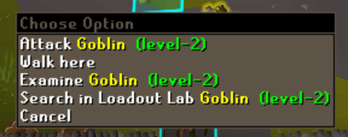

### Multi-mob rosters: groups and raids

One trip rarely means one monster. Any result grows into a roster: the
'+ Add mob' row appends another target, and searching a curated group
lands the whole lineup at once - Fight Caves, the Inferno, Zulrah's
forms, Dagannoth Kings, Barrows, Tormented Demons, the Theatre of Blood,
Tombs of Amascut, Chambers of Xeric, the Fortis Colosseum, Nex, Yama and
more. The optimizer then finds ONE shared set per style across the whole
list - the kit you actually bring - with each mob shown as its own row:
its dps in that shared set, the style that answers it, and a lens that
flips every card and number to that mob on click. Any mob can leave via
its row's X (the last one closes the result), so a raid roster can be
trimmed to the rooms you actually fight, and a right-click on a row
offers Move up / Move down to put the list in the order you run it -
a reorder never recomputes, the results simply follow their rows. A
group opens with an Inventory of 4 swaps and a raid with 12 (a single
mob with 1); the Tombs of Amascut roster runs Akkha through his final
stand and ends on one enraged Warden, the one you left alive. Raids
compute under their own animation - the Obelisk charging, Verzik, Olm's
turning head - and Zulrah under his. Inside raids, Detect on the
boost picker assumes the raid's own boost (CoX overload (+), ToA salts);
pick any other tier to bring your own potions instead - and ToA
results carry an Invocation chip (0/150/300/540) applying the official
calculator's defence scaling, so weapon rankings hold at the raid
level you actually run.

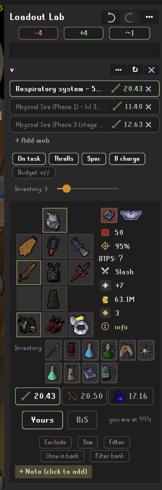

Curated raid groups can carry stipulations the shared kit obeys: at
Tombs of Amascut the P2 Wardens weigh three times their hitpoints when
the kit is chosen, so the shadow set survives a small inventory, and the
Wardens' spec is always the dragon dagger, the community's proven choice
for breaking into the next phase.

### Monster thumbnails

Each roster row carries its monster's picture from the OSRS wiki -
per-form for versioned bosses, fetched once and cached. The Connections
config section has the switch (on by default); off means no wiki
requests and plain text rows.

### Slayer task toggle

Flip the slayer-task toggle to fold in slayer-helm bonuses; bosses locked
behind an active task are greyed out. Selecting a slayer monster opens
the toggle on, since most people meet one through a task; anything else
opens it off, and a raid never counts. The seed runs at every selection,
so flip it after selecting when you are off task. The Slayer task bracelet setting
(Defaults section, or right-click any card's bracelet cell: "On slayer
tasks: ...") pins the Expeditious bracelet or the Bracelet of slaughter
into every on-task set's hands slot. A mob's own hands pin wins, raids
never count as a task, and like any pin it is unpriced and brought
owned or not.

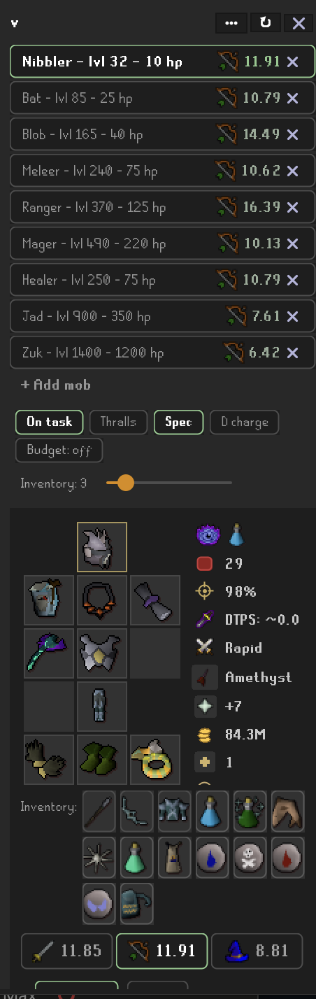

### Undo and redo

The header's back/forward arrows walk your last 50 steps - monster
searches, panel settings, AND edits in one history: search Zulrah,
flip the slayer toggle, search Vorkath - back, back, back retraces
each of those in turn. Steps cover: monster selections; the toggles
(F2P, slayer task, wilderness, low-risk, Protect Item); the spellbook
and risk-cap dropdowns; the upgrade budget; the dragonfire pick; and
every edit (exclusions, pins, notes, simmed items, protect-only
flags, pinned spells, trip supplies). Hover for
exactly what's next ("Back: Spellbook: Ancient").
Scan-driven changes (bank snapshots, storage captures) are never
steps - only what you deliberately did. History is per-session and
resets on profile switch.

## 2. Read the answer

Every style card is a full battle plan - and every line of it can be
toggled in the Display options or compared against the true game-wide
ceiling. When it is time to gear up, the same answer projects into your
bank.

### Best owned set per style

Pick a monster and Loadout Lab computes the strongest set you actually
OWN for melee, ranged, and magic - with exact DPS, max hit, and accuracy,
verified against the official wiki calculator. When poison tiers of the
same weapon tie on stats, the strongest venom wins the suggestion
(dragon dagger p++ over plain, main hand and spec alike). When a Rada's
blessing stat-ties with a god blessing you also own, Rada's rides: the
teleports are the free edge.

### Game-best ceiling comparison

Every style card can show the true best-in-slot ceiling set beside yours,
so you see how close your kit is. The ceiling honours your levels but never
your quest log: Barrows gloves sit in it before you finish Recipe for
Disaster. Slots where you already own the best (or a stat-identical
analog) get a gold border - but only where nothing in the game would
raise the dps of the set you are wearing. An occult necklace under a
Fire Bolt staff gets no border: a fire amulet beats it there, even
though the ceiling set (a Shadow) wears the occult.

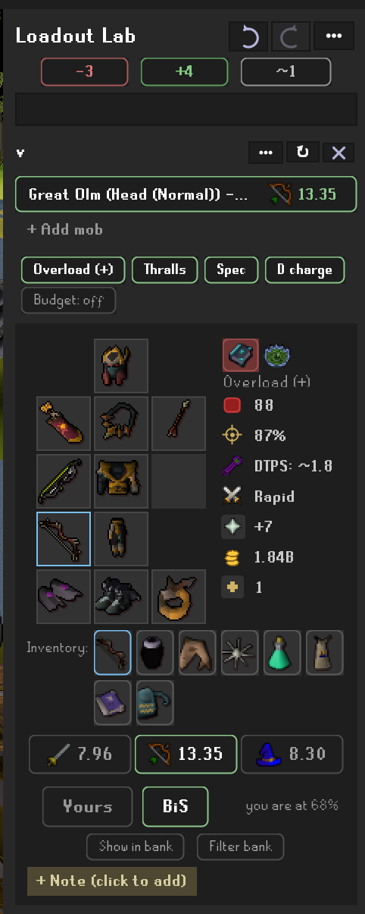

### Incoming damage and protection prayer

See how hard the boss hits YOU in the chosen set, from curated per-boss
attack data, plus which protection prayer to use - including bosses whose
attacks partially pierce prayer.

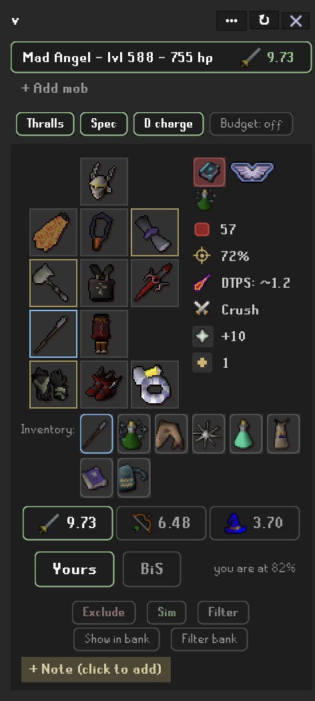

### Spell and spellbook recommendation

On the magic card, Loadout Lab shows the spell to autocast. Click it to
pin a spell, or lock the spellbook (standard, ancient, lunar or arceuus)
so the suggested spell and set adjust to match. Locking a book with no
autocast spell, like Lunar for Cure Me, leaves the card to built-in
staves such as the trident or the warped sceptre. A pinned built-in staff
always casts its own spell, even with another spell pinned.
Bolt spells count chaos gauntlets (+3 max hit), and every elemental spell
counts the elemental amulet or its own element's amulet (+2), so a Fire
Bolt set can beat a Fire Blast one when you own the gauntlets.
A charged tome of water, fire or earth in the shield slot adds 10%
damage to a standard-spellbook spell of its element, and the water tome
10% accuracy as well (an empty tome, an off-element spell or an
Ancients spell gets nothing), so Water Surge with the tome beats the
fortified ward at a drake.
Sunfire runes give a standard fire spell a minimum hit of a tenth of its
max hit (taken before the tome's damage step, as the official calculator
does). A card whose spell is a fire spell gets a sunfire plate in its
header, seeded from your collection at each selection (sunfire runes
anywhere the scan sees them) with Detect best on its menu; pick sunfire
or fire runes to change it, and the trip runes follow. The Best in game
card always assumes sunfire runes. A tome of fire charged with searing
pages has the same effect; the scan cannot tell its pages apart, so pick
sunfire runes on the plate yourself.

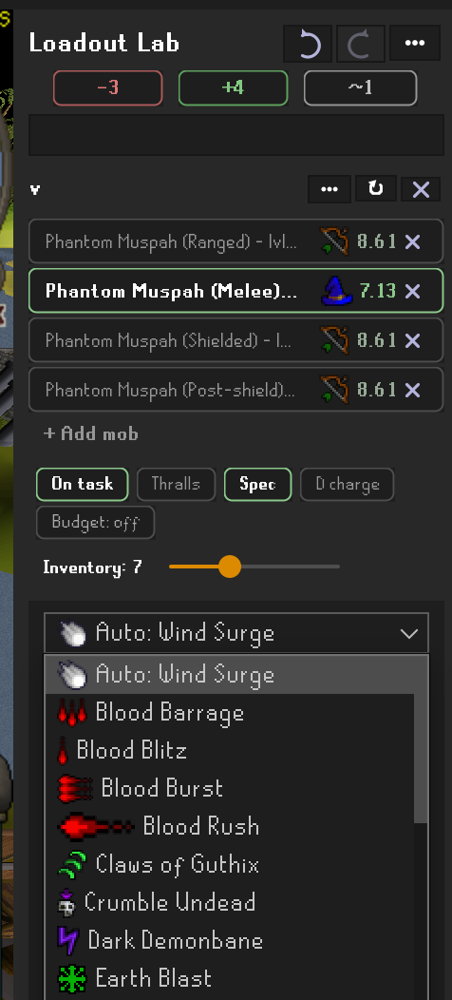

### Bank tools: show and filter

"Show in bank" outlines the set's items in your bank; "Filter bank" shows
only them, arranged like the in-game equipment and inventory tabs - the
worn set as the equipment cross, the carried kit in a 4-wide block beside
it: the inventory swaps, the trip's runes with their pouch and casting
cape, every dose of each supply pick, the potion the card assumes, and
the mob's own "~" filter list. Uses the core Bank Tags plugin.

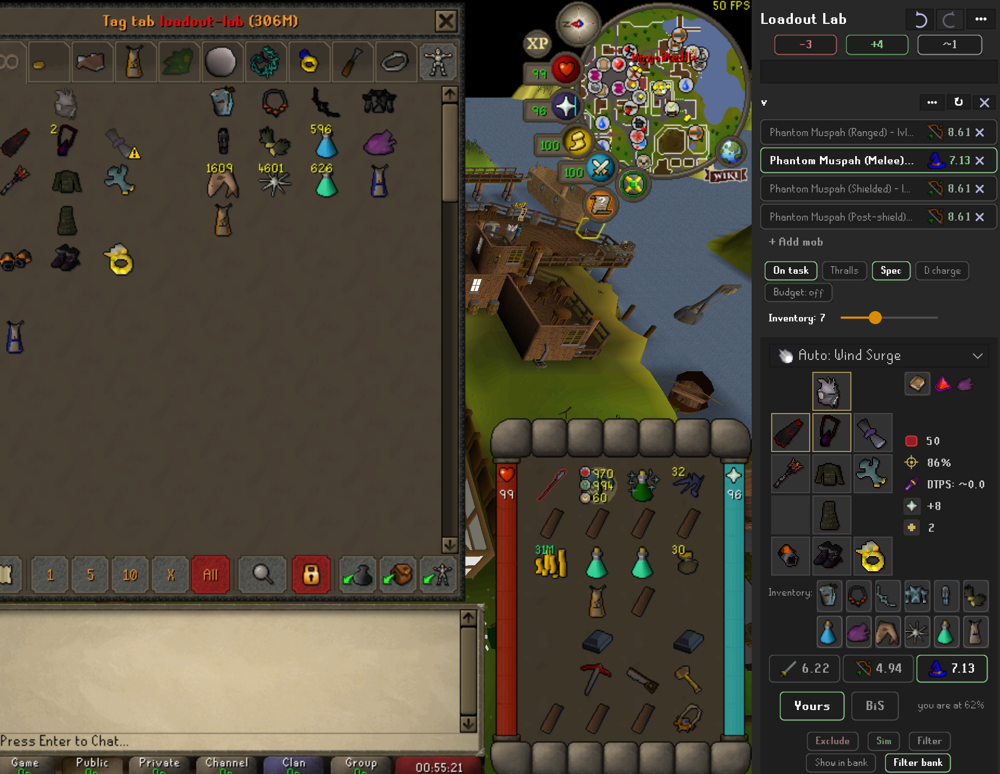

### Wiki calc link

"Wiki calc" opens the exact setup you are looking at in the official
OSRS wiki DPS calculator - gear, levels, prayers, boosts, the loaded
dart, even the ToA invocation level. Full setups cannot ride a URL, so
the click shares the setup through the wiki's shortlink service first
and opens the calculator on the returned id. Strictly click-initiated:
no network request ever fires on its own.

## 3. Shape the fight

The computed answer is a starting point. Every assumption is a control:
the chips on each card, the prayer and boost pickers, the inventory
budget, simulated gear, budgets and risk caps - tune them and the
optimizer re-answers.

The copy report names your global excludes and, under each mob, its
pins by slot, per-mob excludes and sims, note and Degrades skip, so an
empty card can be diagnosed from the report alone.

### Assumption pickers: prayer and boost

The prayer and potion icons on each style card are pickers. Detect best
stays the default - the boost detect reads what you actually own, the
prayer detect your unlocks - and clicking an icon overrides that style's
assumption: any named tier (Piety, Chivalry, Rigour, Deadeye, Augury,
Mystic Might...), any boost including overloads and smelling salts
outside raids, or None. Divine potions are preferred: the BiS ceiling
assumes the divine super combat / divine ranging potion, and your side
assumes the divine variant whenever you own one (same boost numbers,
but the boost holds at ceiling instead of decaying). An accent border marks an override; the numbers,
the assume label and the consumable cells all follow. Handy when a low
prayer-bonus setup cannot sustain Piety and you want the DPS you will
actually do.

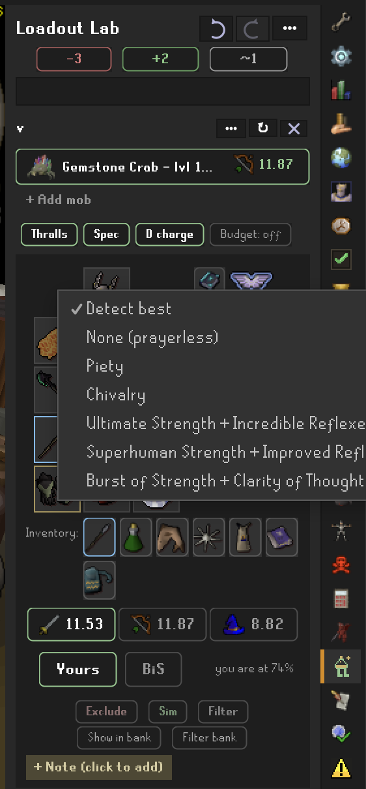

### Spellbook Swap and Vengeance

Click the spellbook plate on a card to bring the runes for a Spellbook
Swap and a Vengeance cast, on top of whatever thralls and Death Charge
already ask for. The option appears only if you can reach 96 Magic with
a boost.

This changes the trip's runes and nothing else - Vengeance does return
damage, but modelling that honestly is its own problem, so no DPS
number moves.

A fight whose mechanics want a particular book (the Sire's Shadow
Barrage stun on Ancients) shows that book on the plate, and its magic
card autocasts from that book too; lock a book yourself or pin a spell
and your choice wins.

### Thralls and Death Charge

Arceuus support, modeled honestly. The Thralls chip appears when your
Magic reaches a tier (38/57/76) and you own the book of the dead - it
defaults ON (a thrall is summoned once a minute and rides across the
kills of a grind, so its value applies to a task mob exactly as it
does to a boss), folding the tier's flat dps
(greater: 0.625, always hits) into the shown numbers, exactly like the
official calculator's thrall toggle; the tab tooltip shows the
gear/thrall breakdown, and the ranking never moves (a thrall adds the
same to every set). The D charge chip assumes Death Charge - seeded on only when you can
actually cast it (members, Magic 90 reachable with a boost you own,
A Kingdom Divided done, blood/death/soul runes banked) -
15% special attack energy per killing blow, once per 60-second cast -
feeding the spec model's energy budget, so long energy-bound fights fit
more special attacks. The budget is regen over the kill, the sustained
rate of a grind; a fight you enter once with a full bar - Hespori,
Skotizo, the Mimic, Jad, Zuk, the Hunllefs, Obor, Bryophyta - counts the
opening 100% too, so two claw specs price as two, not as a fraction. Both recommendations carry their dependencies:
the book of the dead (a thrall is cast from it with any weapon - no
powered staff needed) and your best rune pouch join the trip cells, and
the resurrect / Death Charge / Mark of Darkness runes (the last when
your magic card casts Demonbane) join the bank filter and setup layout.
(Vengeance modeling is roadmapped.)
Both are cast from Arceuus, so a magic card whose autocast is on another
book (Water Surge, Ice Barrage) cannot have them: that card stands down,
shows its number without the thrall, and says why under its gear; the
melee and ranged cards, powered staves and Arceuus spells keep the fold.

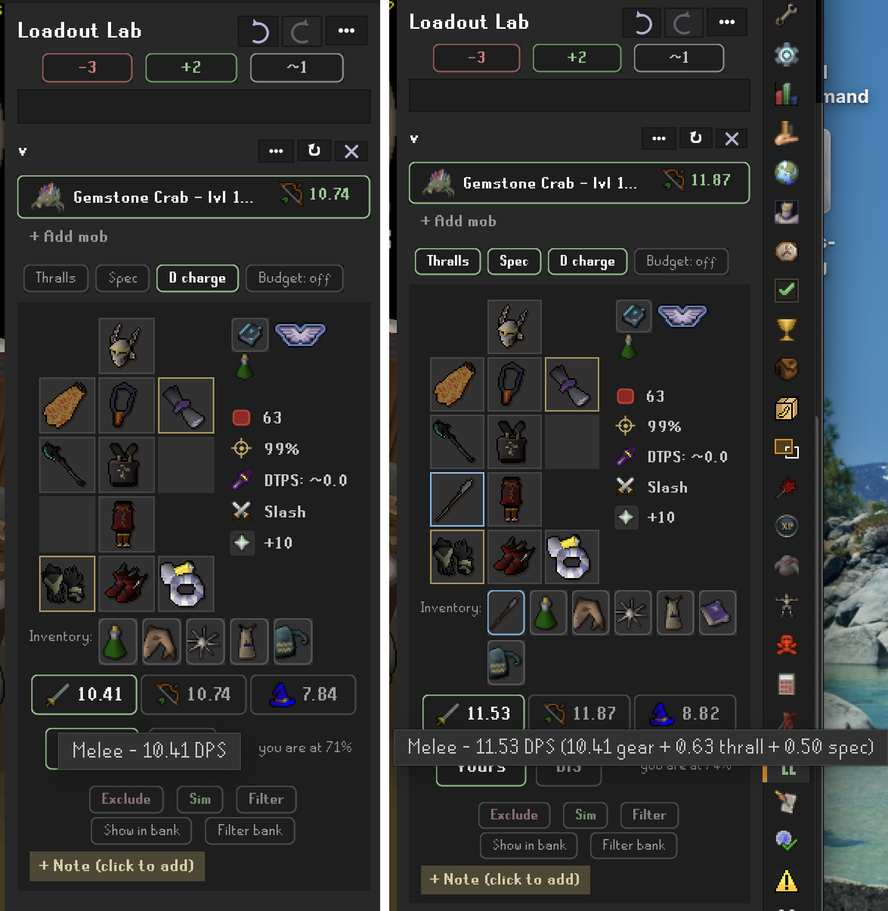

### Multi-combat card

A mob that is fought in a multi-combat area (multi_mobs.json, curated
from the wiki - the Catacombs, the Wilderness Slayer Cave, the God Wars
Dungeon and friends) puts a Single chip among the search chips. Click
it to cycle Single, Multi x3, Multi x9. On Multi the three style tabs
give way to the three multi tools, ranked: the best burst or barrage
set (Ice Barrage, or Ice Burst under 94 Magic), the best chinchompa set
(your best owned chins; black for Best in game) and the venator bow set.
Each is the normal per-target set with the tool pinned, multiplied by
the stack the chip names (3 or 9 targets): barrage and
chins hit every target in the 3x3 up to nine, the venator bow bounces
to two more at two-thirds of its max hit on their own accuracy rolls,
so its factor comes from the max hit (about 2.3 at a 30 max). The tab
header shows the factor, the tooltips and the Copy report the per-target
numbers. A tool you do not own (the bow and its arrows, chins, the
barrage's runes) has no Yours row; Best in game always ranks all three.
Melee has no multi tool and is not on the card. The stack is an
assumption, not a simulation of how many actually stand in the 3x3,
and the official calculator has no multi, so only the per-target rows
are verified against it. The trip kit is unchanged by the Multi view.

### Inventory budget: swaps vs bag space

The Inventory slider on a roster sets how many carried swaps the shared
set may lean on, and it optimizes honestly in BOTH directions. Push it
up and the optimizer may answer different mobs with different weapons or
armour pieces - more dps, more slots. Pull it down and it hunts the best
single set that needs nothing carried - more room for food and loot on a
long trip. The special-attack weapon occupies a swap slot whenever it
differs from the worn weapon, so the spec is never free bag space. When
the main weapon is two-handed and the spec weapon is not, a second slot
brings the best offhand (a defender, say) for the switch.

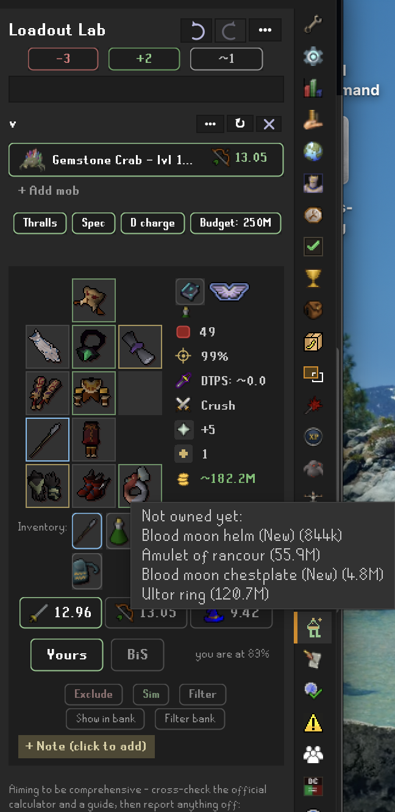

### Trip supplies

Excludes, sims and bank filters form a trio - red, green and grey - at
two levels: global chips above the search bar, and per-mob "here" chips
on every card that override the global level. The grey member manages
the trip kit: persistent defaults for the food, fast food, prayer
restore, surge potion, spellbook-swap cape and anti-venom every trip
brings, plus an always-filter list ("Always show in bank filter...")
for items like teleport capes that belong in every bank view - it shapes
the bank view only, never the recommended set. Poisoners that do not envenom (the Dagannoth Kings' spinolyps, Kalphite
Queen, Sarachnis, Scorpia) get an antipoison slot: Antidote++ down to
Antipoison by what you own. Against venomous monsters the anti-venom slot
also offers Cure Me (Lunar runes; venom becomes poison) and the prayer
book with a holy symbol (cures for prayer points), as choices rather than
detected tiers. On a venomous mob the poison plan also sits in the card's Assumes row,
right after the boost: the Cure Me spell, the chosen potion or the prayer
book; click it to change. A fire-breather gets a dragonfire plate beside
it: the shield the set must carry, an antifire potion or a super antifire,
seeded from the best potion you own at each selection, with Detect best
on its menu to run that again after a manual pick; the chosen potion
rides the Supplies row and the bank filter like any other supply. Potions
in the bank's potion storage count as owned for all of this. The Best in
game card is the ceiling and always assumes a super antifire, so its
shield slot goes to dps. Choosing Cure Me camps the trip on Lunar: the
magic card locks to built-in staves and thralls and Death Charge stand
down. It is
not offered while a pinned spell or a spellbook lock relies on another
book. Detect best picks the highest tier your
collection has; anti-venom only joins the kit against monsters that can
actually inflict venom (Zulrah, Araxxor, Vorkath and friends). On a
wilderness trip a banked blighted variant (anglerfish, manta ray,
karambwan, super restore) wins detection outright - cheap to lose, and
only edible there - and on land it is never picked. The potion a card
assumes rides its Supplies row too (raid-supplied overloads and salts
do not; the raid hands those out), and a sea-only trip packs repair
kits and nothing edible, since the boat takes the hits. Chosen supplies
ride the result card's consumable cells, the bank filter (every dose
matches) and the filtered bank's inventory block. The Cannon submenu
brings a dwarf multicannon - base, stand, barrels, furnace and
cannonballs, five cells in the Supplies row and the bank filter - on
land, non-raid trips. It is never detected, adds nothing to the dps
numbers, and does not know where cannons are allowed.

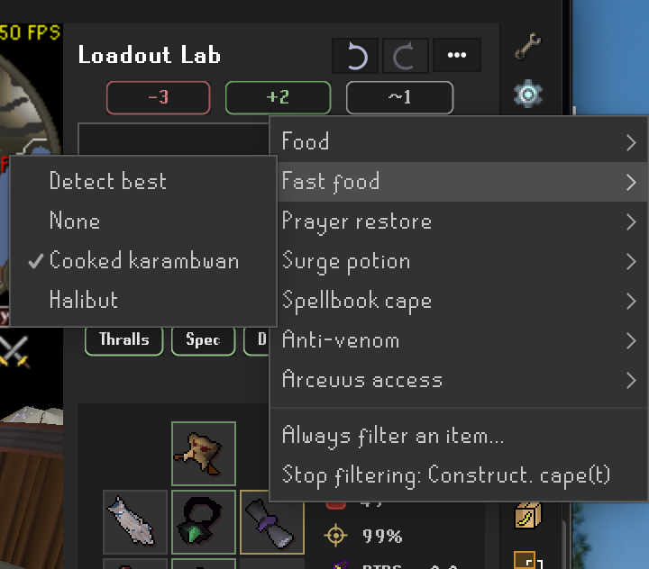

### Simulated items

Right-click any suggestion you do not own ("what if I had a tbow?") to
sim it - considered as owned - and see the set it would build. Any item
can be simmed proactively from the green + chip above the search bar or
the header "..." menu ("Sim an item"), both of which also list your
current simmed items so one that never wins a slot can still be
removed.

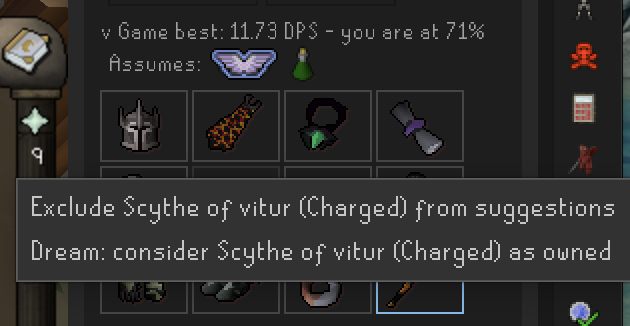

### Upgrade budget

Enter a gp budget and Loadout Lab suggests buyable upgrades within it; use
"-" for the unlimited ceiling. Quest rewards join for free with their
source quest named.

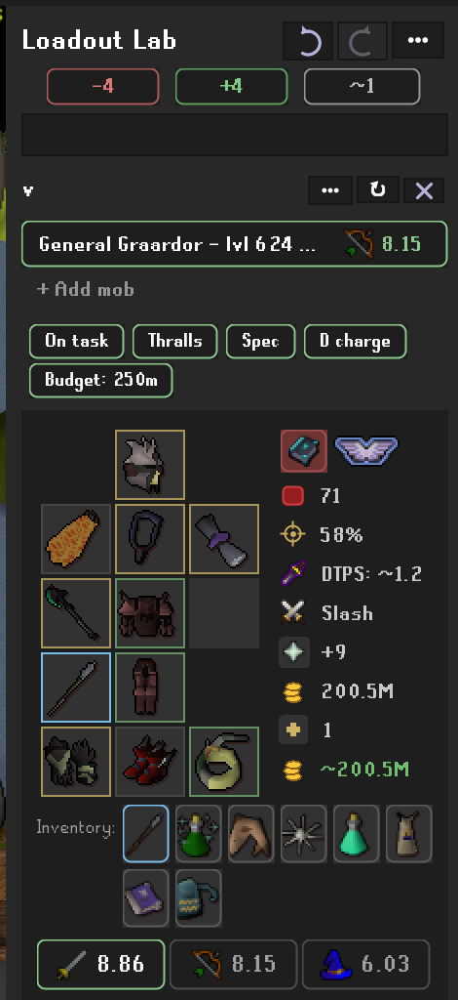

### Exclude items from suggestions

Right-click a suggestion to protect rare supplies (like dragon darts) so
the optimizer stops recommending them - everywhere, only against this
monster, or only against this monster's melee/ranged/magic set. Per-mob
exclusions are managed from the "This mob" line: each of its lists
(excluded, simmed, bank-filter items) has a "Clear all" entry, one undo
step for the whole list.

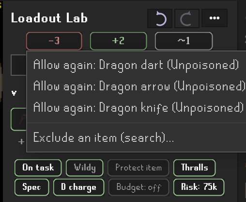

### Degradable gear chip

A card whose set wears down or burns charges (Barrows, Moons, crystal,
tentacle, blowpipe, tridents, charged raid weapons) shows a fourth sigil
on its "This mob" trio: "*2" means two such items are in the set. Click
it to skip that gear for the mob (it turns amber) and
the card recomputes from what is left, so a set of moon tassets gives way
to dragon platelegs. Click again to allow it. Charge-once items (the
dragonfire shield and ward, the ancient wyvern shield) and corrupted
crystal never count. The chip lives in the Controls settings; Defaults
can start every mob with degradable gear skipped.

### Wilderness low-risk sets

Build low-risk sets around the items-kept-on-death rules: your most
valuable items ride protected while everything else stays under an
adjustable gp risk cap. Per-item death fates and honest kept/lost gp
totals include untradeable repair and mangle fees - and curated
"rebuild errand" friction for gear that is gp-free to replace but
costs a real trip (the salve line's tomb-and-re-imbue run, an imbued
ring's re-imbue visit). Low-risk sets NEVER put such an item at risk:
it may ride a kept slot (a protected slayer helmet is standard
practice), but if it would be lost or broken it is swapped out of the
suggestion entirely, no matter the risk cap.

You can extend that treatment to any item yourself: right-click a
suggestion shown with the death skull and pick "Only bring if protected
on death". The optimizer then keeps that item protected or leaves it out
of the set - never risking it - just like the rebuild-friction gear.

On a wilderness trip the inventory joins the kept/lost lists too. A
trouver-locked rune pouch and an untradeable casting cape read as kept;
the runes you cast with (a locked pouch does not protect its contents)
and every supply pick read as lost. Those lines are fates, not gp: the
risk total still prices worn gear and the spec weapon, because a trip's
food and rune counts are yours to decide.

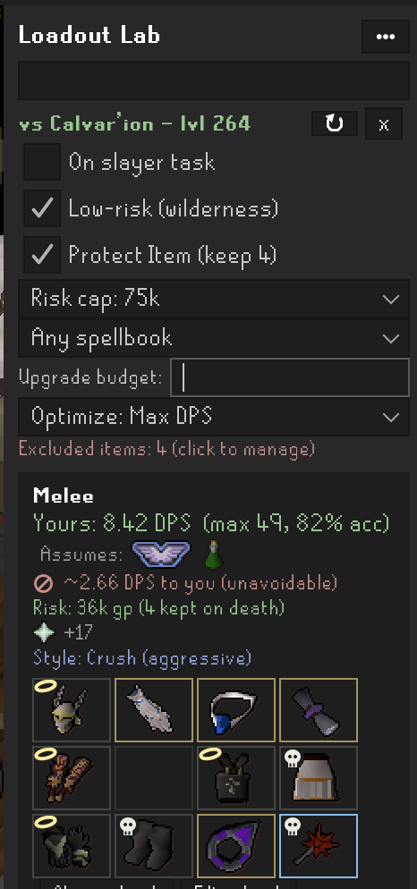

### Revenant and wilderness gear conditionals

Charged wilderness weapons (Craw's bow, Webweaver bow, the chainmaces,
the sceptres) get their +50% accuracy and damage against wilderness
monsters. The Amulet of avarice boosts you against revenants - and the
risk model knows it keeps you skulled, so your usual three protected
items drop to zero (one with Protect Item). A charged Bracelet of
ethereum zeroes the revenant incoming-damage line. All verified against
the official wiki calculator's engine.

Monsters that also live outside the Wilderness (hellhounds, dust
devils, green dragons...) get an "In the Wilderness" checkbox: the
+50% and the risk options apply only when you say the fight is
actually happening there. Wilderness-exclusive monsters (revenants,
the boss ring) are always "in".

### Required slayer protection

Some monsters mandate an item before the fight is even playable: a
mirror shield or V's shield against a basilisk's or cockatrice's gaze,
earmuffs against banshees, a nose peg against aberrant spectres, a
facemask against dust devils, a spiny helmet against wall beasts,
insulated boots against killerwatts, slayer gloves against fever
spiders, reinforced goggles against sourhogs (the slayer helmet stands
in wherever one of its components would), and a lit bug lantern to
harm harpie bug swarms at all. Loadout Lab equips the requirement
automatically on BOTH the Yours and BiS sides: the slot's candidates
collapse to the acceptable items, and weapon lines that cannot comply
(a two-hander against a required shield) are discarded. Own none of
the acceptable items and the best unrestricted set still shows, with
the info line explaining what is missing. Pinning the slot overrides
the requirement - your explicit choice always wins.

## 4. Make it yours

Set your own defaults, teach the plugin what you own wherever it is
stored, and pin the per-mob decisions worth remembering.

Everything in this section is saved **per character**, not per RuneLite
profile: your main's excludes, sims, filters, pins, notes, trip kit and
panel defaults stay on your main, and an alt or an ironman starts with
its own. Leagues and the main game count as separate characters for the
same account. Lists made before 0.4.1 carry over to the first character
you log in as.

Outside the Chambers of Xeric, lizardman shamans require the full tier-5
Shayzien set: it negates their acid spit and its prayer-ignoring poison,
where lower tiers only soften it. The hard Kourend & Kebos diary lets a
slayer helmet stand in for the helm, so on task the helm slot may keep it.
A piece you do not own frees only its slot, and the note says so.

### Panel options: display and controls

Every card line and control is optional, across three settings sections.
Display toggles each detail line (max hit, accuracy, damage taken, the
defensive-prayer call, risk on death, prayer bonus, attack style, the
inventory row, game best, notes, the '+ Add mob' row, the footnote, the
loading animation, and where the spec and thrall dps appear - in the
numbers, as a footnote, or not shown). Controls picks which chips and buttons appear
(exclude / sim / filter / pins, bank buttons, spell selection, budget and
wilderness controls, the Degrades chip, and whether a sea card's trip
ledger opens expanded or as its total line). The last section, Reset,
is folded by default and holds only **Reset to fresh install**, kept
away from the everyday toggles: tick it to put this profile back to a just-installed
state - every setting to its default, the page emptied, and all excludes,
sims, stored-elsewhere and protect-only marks, filters, every mob's pins
and notes, and the supply defaults wiped. Bank memory stays (it is what
the plugin learned, not what you chose), and the tick clears itself.
Customisations live in your RuneLite profile, so reinstalling the plugin
never clears them - this does. Defaults sets what every NEW result assumes: On
task, the Spec chip, thralls and Death Charge (Detect best or None),
autocast (Detect or powered staves only), a prayer tier and a boost PER
STYLE (Detect best, None, or a named pick for each of melee, ranged and
magic), the budget and risk-cap seeds, antifire, and Arceuus via
Spellbook Swap - the per-card chips and pickers still override each mob.

### Mob profiles: pins, notes, and bank-filter items

Every monster remembers your preferences for it - scoped to one combat
set or all of them. PIN an item (right-click a cell's Pin submenu, or
the card's dots menu, both opening the native in-game item search) - a
Bracelet of slaughter stretching that slayer task - and that card
always brings it, owned or not, with the optimizer building the best
set around it; a melee-only pin never touches your ranged card. Pins
outrank exclusions, budgets, and the low-risk safety vetoes while the
risk numbers stay honest, and game best stays unpinned so you can see
what the preference costs. The mob's NOTE is a collapsible post-it
under the storage lines, edited inline - click, type, click away.
BANK-FILTER ITEMS are per-set trip supplies (a super combat on the
melee card, a ranged potion on ranged, sharks everywhere) that join
that card's "Show in bank" and "Filter bank" views. The "This mob: ..."
line manages everything, and each style card collapses to its DPS
header - sets a standard deviation under your best start collapsed.
The magic card hosts its own controls: PIN THE SPELL ("I am casting
Wind Bolt") and the gear optimizes around it, with the spellbook lock
shown while the spell is on Auto. A profile belongs to the monster,
not the card: on a phase roster like the Tormented Demons, a pin or
spell set on any phase card is the demon's and shows on every phase
(and on the plain mob). A mixed roster (Graardor and his minions, a
Tombs trip) reads each member's own profile: a spell pinned on the
fire giant's card is cast against the fire giant alone, and an item
pinned on one member binds that member's own set, with the shared set
and the carried swaps working around it. The pinned spec weapon is
the trip's one shared spec, taken from the first member.

Gear kept where no plugin can see it - an Ultimate Ironman's cold or
nest storage, a friend's holding, anything untracked - counts as owned
when you sim it (the separate Stored elsewhere list folded into sims in
2026-08). The looting bag, POH costume room, STASH units and cargo holds
need no marking - see the next section.

### STASH, POH costume room, and cargo hold tracking

The bank's potion storage is read too: every stored potion the plugin
detects (antifire, prayer restore, anti-venom, antipoison, the boosts,
surge) counts as owned, one potion per four doses.

These storages track natively, the same way the bank does - open each
once and the contents count as owned from then on:

- **STASH units**: read the STASH unit chart (the noticeboard by
  Watson's house) once. Every filled unit across all tiers counts its
  stored items as owned in that single read - no visiting each unit.
- **POH costume room**: open a costume storage (armour case, wardrobe,
  treasure chest, cape rack) in your house once.
- **Cargo holds**: open a boat's cargo hold once - cannonballs stored
  there count for ranged setups.
- **Rune pouch**: the runes inside your rune pouch (divine or plain)
  count the moment they change, wherever the pouch sits - so moving
  every blood rune into the pouch no longer drops Fire Wave from the
  magic set.

### Where your gear is (location hints)

The ledger remembers which storage each item was seen in, not just that
you own it. Suggested items that need a fetch trip - a STASH, the POH
costume room, a cargo hold, the looting bag - carry a small colored dot
in the cell corner naming the storage, with a "Stored:" legend under the
cards that lists only the sources actually on screen. Gear at hand
(equipped, inventory, bank) stays unmarked, so an all-bank set shows no
dots and no legend at all. The tooltip spells it out too ("stored in
STASH"), and the profile export carries the same per-source breakdown
for bug reports.

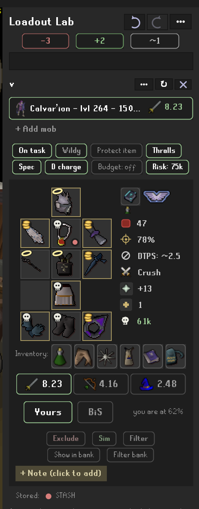

### Dude, Where's My Stuff link

If you run the Dude, Where's My Stuff plugin (2.11.5+), the gear
storages it tracks are also counted as owned - useful for death storage
(which Loadout Lab does not track) and for storages you opened before
installing Loadout Lab. Loadout Lab asks DWMS directly over the
PluginMessage bus and gets its exact tracked items back, storage by
storage, feeding both ownership and the location hints. The
simmed-items list remains the manual override (it absorbed the old
"stored elsewhere" list in 2026-08), and a muted panel line shows how
many items came in this way.

### Ship combat (cannons)

Sea monsters from the Sailing update - sharks, krakens, rays, orcas and
the rest - are fought from your boat: their search rows turn sea-blue and
wear the sailing icon, and the selected row and card header carry it too. The Cannons chip (0 / 1 / 2) rides the chip
row; the cannons themselves live on the card - a cannon / ammo / cannon
strip between the assume icons and the gear grid, each opening the same
picker rack as the boosts and prayers. A cannon's rack picks its
material (all seven, bronze to dragon) AND who fires it: you, or a
crewmate at Privateering 1-4 - picking a material automatically raises
the crew to the minimum that can man it, and rune/dragon cannons demand
P4. The cannonball picker offers one shared tier - only tiers every
carried cannon can fire, so a mithril + dragon pair tops out at mithril
balls. The card never hides: a ledger under the gear view adds it up in
plain lines - set, spec, gear, each cannon, total - and the total is the
number on the style tab and on the mob's roster row, so a sea row ranks
player plus cannon like the card does. Click the ledger to collapse it to
the total line alone (the Sea trip breakdown setting remembers the
choice per profile). Manning a cannon means your armour still counts
(its ranged bonuses boost your cannon) while your weapon does not, and
the ledger says so. Sea monsters hit the BOAT, not you: the damage-taken
line prices your keel (bronze through dragon, or none) from the wiki's
boat combat table, click it to change the keel, and a sea-only trip's
Supplies row packs ship repair kits only when that keel can actually be
hurt. "Copy report" carries the whole ship - keel, damage taken, station,
ammo, every cannon with its operator and dps or blocking reason, and
each mob's own cannon dps - so a sea bug report needs nothing else.
While a sea result computes, the loading animation sails: a sloop under
gulls, a pivoting cannon, a kraken rising beside the boat. Player-fired numbers follow the
wiki's documented formula exactly; the crewmate formula is under
review on the wiki, so crew numbers track the last documented one.
Melee cannot attack from a boat, so sea monsters carry no melee card
and melee spec weapons never ride a sea trip; thrall resurrections
cannot be cast on a boat, so thralls add nothing at sea.

### Compute animations

Every compute plays a mood in the panel while the numbers cook, drawn
from the monsters' own wiki renders in colour: sixty-odd bosses, groups
and raids have their own - the King Black Dragon breathing three fires,
Zulrah changing colour as its forms cycle, the Theatre and the Chambers
in cuts, Vorkath's acid trail, the Hydra losing a head a phase - every
non-boss dragon shares a tinted family mood, sea trips sail, and
anything else keeps the flask with the Loadout Lab legs. The frames
live in a resource, so they cost the plugin nothing at review; the
generators live under scripts/art and every mood is a work in progress.

### Community Discord

The header Options menu has a "Join our Discord" link to the plugin's
community server.

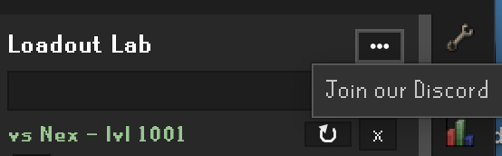

